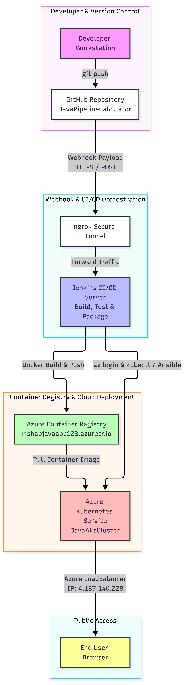

# Cloud-Based CI/CD Pipeline for Java Spring Boot on Azure AKS

A production-grade, end-to-end DevOps pipeline demonstrating automated Continuous Integration and Continuous Deployment (CI/CD) for a Java web application deployed on Microsoft Azure Kubernetes Service (AKS).

---

## 🚀 Project Overview
This project implements an automated release workflow. Whenever code is committed and pushed to GitHub, a webhook triggers a multi-stage Jenkins pipeline that builds the Java application, executes automated JUnit tests, containerizes the artifact via multi-stage Docker builds, pushes the image to Azure Container Registry (ACR), and rolls out zero-downtime updates to an Azure Kubernetes Cluster using Ansible and `kubectl`.

---

## 🛠️ Architecture & Workflow

  
  
---

## 🧰 Tech Stack & Tooling

| Component | Technology | Purpose |
| :--- | :--- | :--- |
| **Source Control** | Git & GitHub | Version control and webhook event emission |
| **Build & Test** | Apache Maven, JUnit | Dependency management and unit test execution |
| **Runtime** | Eclipse Temurin JDK 17 / Tomcat | Java compilation and container execution environment |
| **Containerization** | Docker | Multi-stage image packaging |
| **Registry & Cloud** | Azure ACR & AKS | Private container registry and managed Kubernetes cluster |
| **Orchestration** | Jenkins | CI/CD pipeline automation server |
| **Deployment** | Ansible & `kubectl` | Declarative Kubernetes manifest rollout |
| **Tunneling** | ngrok | Secure HTTPS webhook forwarding |

---

## ⚙️ CI/CD Pipeline Stages

1. **Checkout Source**: Pulls the latest commit from the `main` branch.
2. **Build & Test**: Executes `mvn clean test package` to compile sources and run automated unit tests.
3. **Docker Build**: Builds a container image tagged dynamically with the Jenkins `BUILD_NUMBER` and `latest`.
4. **Push to Registry**: Authenticates with Azure Container Registry and pushes image layers.
5. **Deploy to AKS**: Authenticates via Azure Service Principal, updates deployment manifests dynamically, and executes the Ansible deployment playbook.
6. **Verify Deployment**: Inspects pod health and LoadBalancer service endpoints.

---

## 🌐 Live Application Endpoint
* **Public Access URL**: `http://4.187.140.228`
* **Resource Group**: `JavaAppRG3`
* **Cluster Name**: `JavaAksCluster`
* **Container Registry**: `rishabjavaapp123.azurecr.io`

---

## 📦 Repository Structure
* `src/`: Java application source code and unit test files.
* `k8s/`: Kubernetes deployment and service YAML manifests.
* `playbook.yml`: Ansible automation playbook for cluster updates.
* `Jenkinsfile`: Declarative 6-stage CI/CD pipeline definition.
* `Dockerfile`: Multi-stage container build configuration.
